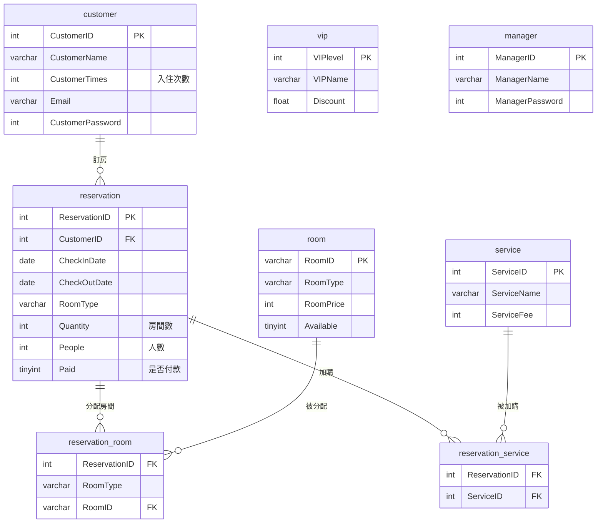

# 凝萃文旅：飯店訂房管理系統

以 **PHP + MySQL/MariaDB** 製作的飯店訂房系統（資料庫課程專題）。分成「顧客」與「管理員」兩種身分：顧客可以查詢空房、線上訂房、查看帳單與付款；管理員可以管理顧客資料、查看營業報表。

> ⚠️ 本專案為課程作業，僅供學習與展示。「凝萃文旅」名稱、飯店簡介及外部引用圖片僅作示範用途，與任何真實業者無關，圖片版權屬原作者所有。

---

## 功能

### 顧客端（`customer/`）
| 頁面 | 功能 |
|---|---|
| `customer.php` | 個人主頁：姓名、會員編號、VIP 等級、入住次數 |
| `search.php` | 依入住／退房日期查詢各房型剩餘房間數 |
| `booking.php` | 線上訂房：選擇房型、房間數、人數、附加服務，系統自動分配房號 |
| `bill.php` | 查看所有訂單與金額（含 VIP 折扣），可付款或取消未付款訂單，每頁 10 筆 |
| `edit.php` | 修改密碼 |

### 管理員端（`manager/`）
| 頁面 | 功能 |
|---|---|
| `manager.php` | 管理系統首頁 |
| `customer_management.php` | 顧客列表與 VIP 等級，可依姓名或會員編號搜尋 |
| `reports.php` | 營業報表：總收入明細、訂房次數前 5 名顧客、近 6 個月高預訂率房間、最常被預訂房型 |

### 商業邏輯
- **空房判斷**：同房型在 `[入住日, 退房日)` 期間內已被預訂的數量，從總房數扣除。
- **房號分配**：依房號由小到大，挑選該期間內未被佔用的房間。
- **金額計算**：
  `(房價 × 晚數 × 房間數 + 服務費 × 晚數 × 人數) × VIP 折扣`
- **VIP 等級**（由 `customerwithvip` 檢視表依入住次數自動計算）：

  | 入住次數 | 等級 | 折扣 |
  |---|---|---|
  | 3–5 次 | 相遇卡 | 95 折 |
  | 6–9 次 | 綻放卡 | 9 折 |
  | 10 次以上 | 璀璨卡 | 8 折 |

---

## 技術

- PHP 8（mysqli）
- MySQL / MariaDB 10.4+（開發環境為 XAMPP）
- HTML + CSS（無前端框架）

---

## 資料庫結構



- **檢視表 `customerwithvip`**：合併 `customer` 與 `vip`，依入住次數算出 VIP 等級與折扣。
- **預存程序 `AssignRoom(res_id)`**：依訂單自動分配空房（網頁端目前以 PHP 實作相同邏輯）。

### 房型與價格

| 房型 | 房號 | 數量 | 每晚房價 |
|---|---|---|---|
| single 單人房 | A001–A015 | 15 | 1,600 |
| double 雙人房 | B001–B035 | 35 | 3,500 |
| triple 三人房 | C001–C010 | 10 | 5,000 |
| quad 四人房 | D001–D020 | 20 | 7,000 |

附加服務（每人每晚）：早餐 200、晚餐 500、SPA 200、泳池 150、下午茶 250。

---

## 安裝與執行（XAMPP）

1. 安裝 [XAMPP](https://www.apachefriends.org/)，啟動 **Apache** 與 **MySQL**。
2. 將本專案放到 `C:\xampp\htdocs\hotel\`。
3. 開啟 <http://localhost/phpmyadmin>：
   1. 新增資料庫 `hotel`（編碼選 `utf8mb4_general_ci`）。
   2. 選取 `hotel` → 「匯入」→ 選擇 `hotel.sql` → 執行。
4. 瀏覽 <http://localhost/hotel/index.php>。

資料庫連線設定在 `hotel_open.inc`，預設為 XAMPP 的 `root`／空密碼。若你的 MySQL 帳密不同，請修改這個檔案：

```php
$link = mysqli_connect("localhost", "root", "");
```

> **在 Linux / macOS 上執行**：程式中的資料表名稱有大寫（如 `Customer`），但 `hotel.sql` 建立的是小寫（`customer`）。Windows 不分大小寫所以沒問題，Linux 上則需要在 MySQL 設定檔 `[mysqld]` 加上 `lower_case_table_names=1`，**並在匯入 `hotel.sql` 之前**重新啟動 MySQL。

---

## 測試帳號

| 身分 | 帳號 | 密碼 | 備註 |
|---|---|---|---|
| 顧客 | `123456@gmail.com` | `123456` | 王小明，璀璨卡（8 折） |
| 顧客 | `234567@gmail.com` | `234567` | 李美麗，綻放卡（9 折） |
| 顧客 | `112233@gmail.com` | `112233` | 曾怡君，無 VIP |
| 管理員 | `1` | `654321` | 管理員帳號為 **ManagerID（數字）** |

其他測試帳號請見 `hotel.sql` 中的 `customer` 與 `manager` 資料表。

---

## 專案結構

```
.
├── index.php                 # 首頁（飯店介紹）
├── login.php                 # 登入頁（顧客／管理員切換）
├── check.php                 # 登入驗證
├── logout.php                # 登出
├── hotel_open.inc            # 開啟資料庫連線
├── hotel_close.inc           # 關閉資料庫連線
├── hotel.sql                 # 資料庫結構與測試資料
├── customer/                 # 顧客端頁面與房型圖片
│   ├── customer.php
│   ├── search.php
│   ├── booking.php
│   ├── bill.php
│   ├── edit.php
│   ├── customer_common_header.php
│   └── room_*.png
└── manager/                  # 管理員端頁面
    ├── manager.php
    ├── customer_management.php
    ├── reports.php
    └── manage_common_header.php
```

---

## 已知限制

本系統以課程展示為目的，**不適合直接部署到正式環境**：

- 多數 SQL 以字串串接組成，有 SQL injection 風險（例如登入驗證）；正式使用應改為 prepared statements。
- 密碼以明碼儲存，且欄位型別為整數（只能使用數字密碼）；正式使用應改為 `password_hash()`。
- 付款功能為模擬，按下後直接標記為已付款。
- 「近 6 個月高預訂率房間」以 `CURDATE()` 計算，測試資料日期為 2025 年，之後執行可能查無資料。
- 首頁與頁首圖片引用外部網址，若來源失效將無法顯示。
